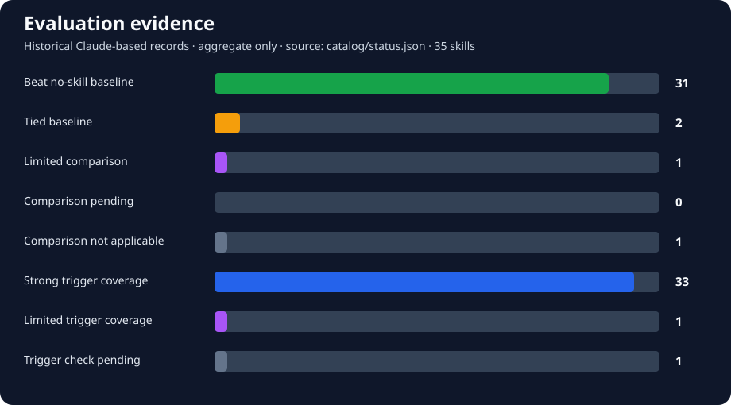

# Tested Agent Skills

Use a skill when you know what you want to achieve but are working outside your usual area. Describe the goal, what you know, and the constraints that matter to you. The skill gives the model domain-specific decisions and checks to consider, such as how to keep an interactive 3D page usable on a basic phone.

Tested Agent Skills started in Claude Code. It includes 35 Agent Skills entries, 26 native Claude Code subagents, and matching portable role briefs. Codex can install the Markdown skills. Check the compatibility notes for entries written around Claude Code workflows.

[Browse the skill catalog](CATALOG.md) · [Claude Code guide](docs/claude-code.md) · [Codex guide](docs/codex.md) · [Evaluation results](docs/evaluation-summary.md)

License: [CC BY-SA 4.0](https://creativecommons.org/licenses/by-sa/4.0/). Commercial use is allowed; attribution is required; shared adaptations use the same license.

## Quick start

With Git, Bash, and Python 3 installed, clone the repository.

```bash
git clone https://github.com/juliomachadome/tested-agent-skills.git ~/tested-agent-skills
cd ~/tested-agent-skills
```

### Claude Code

Preview with `scripts/install.sh --dry-run --target claude --skill copywriting`. To install the skill on this machine, run:

```bash
scripts/install.sh --target claude --skill copywriting
```

### Codex

Preview with `scripts/install.sh --dry-run --target codex --skill copywriting`. To install the skill on this machine, run:

```bash
scripts/install.sh --target codex --skill copywriting
```

Open a new session after installation. The [Claude Code guide](docs/claude-code.md) covers native subagents, and the [Codex guide](docs/codex.md) covers portable role briefs.

## Evidence at a glance

[](docs/evaluation-summary.md)

Historical comparisons on Claude models recorded **31 wins**, **2 ties**, **1 limited comparison**, and **1 command outside the comparison protocol**. See the [classification rules](docs/evaluation-methodology.md#comparison-classification) and [sample limits](docs/evaluation-summary.md). The Codex smoke test checks session execution. Skill loading and answer quality require separate checks.

In a small [Codex browser pilot](https://github.com/juliomachadome/tested-agent-skills/issues/7#issuecomment-7064910093), the existing `web-motion` skill passed **10 of 12 checks**, versus **8 of 12** without it, on two short 3D briefs. It helped defer loading in a simple viewer and restore the poster after WebGL context loss in a custom scene with an interactive section plane. An [earlier run with detailed briefs](https://github.com/juliomachadome/tested-agent-skills/issues/7#issuecomment-7058313151) tied, as did a [separate short prompt for a simple viewer](https://github.com/juliomachadome/tested-agent-skills/issues/7#issuecomment-7065118004). Each pilot used one Codex model, one generation per condition and skill text supplied in the prompt.

- **Skill** = knowledge (rules, diagnosis trees, playbooks, sources) that Claude Code discovers by topic; the full skill and then its references are loaded progressively.
- **Agent** = a specialist that runs in a separate context and can preload skills.
- Follow your project's `AGENTS.md` or `CLAUDE.md` when using skills or agents.

## Works with

The skills are plain Markdown in the open [Agent Skills](https://agentskills.io) format: a folder with a `SKILL.md`. Nothing in them calls a vendor API.

| Where | How |
| --- | --- |
| Claude Code | Skills and native agents install with `scripts/install.sh`. See [the Claude Code guide](docs/claude-code.md). |
| Codex | Skills install with `scripts/install.sh --target codex` (or `--target agents`). `scripts/codex-skill-eval.py` provides an isolated smoke test; use a portable role brief for specialist work. See [the Codex guide](docs/codex.md). |
| Cursor and other Agent Skills readers | The skills use the open `SKILL.md` folder format. Check that tool's own docs for its discovery folder; this repository does not claim a tested integration for every tool. |
| Any other harness (OpenCode, Gemini CLI, Aider, your own) | Add the instructions shown below so it can find and read `SKILLS.md`; the harness must implement that behavior. |
| Any model with no harness (DeepSeek, GPT, Gemini, Llama, a raw API) | `scripts/skill-to-prompt.py <skill>` prints a prompt to paste or send as the system message; it is not automatic skill loading. |

The files in `agents/` use the Claude Code subagent format. For Codex or another tool, use a [portable role brief](agent-profiles/README.md). The [llms.txt index](llms.txt) links AI readers to the catalog, installation guides, and evaluation notes.

Two catalog entries use Claude Code conventions: [`redigir`](skills/redigir/SKILL.md) collects a copywriting brief as a slash command, and [`agent-orchestration`](skills/agent-orchestration/SKILL.md) describes Claude Code delegation. Other tools may need adaptations for these workflows.

## What is inside

| Area | Skills |
| --- | --- |
| Marketing and sales | `copywriting`, `offers`, `ad-creatives`, `paid-traffic`, `seo-geo`, `viral-content`, `storytelling`, `lifecycle-messaging`, `media-production`, `sales`, `customer-support` |
| Product and business | `market-research`, `product-creation`, `product-management`, `business-model-finance`, `process-improvement`, `growth-analytics` |
| Engineering | `engineering-playbook`, `code-craft`, `code-review-criteria`, `software-architecture`, `software-security`, `qa-verification`, `web-performance`, `cloud-deploy-ops`, `mobile-app-engineering`, `llm-engineering`, `agent-orchestration` |
| Design | `ui-design`, `ux-design`, `web-motion` |
| Data | `data-analysis`, `data-engineering`, `data-visualization-dashboards` |
| Command | `redigir` (a guided copywriting brief; typed as `/redigir` in Claude Code) |

Each skill is a folder:

- `SKILL.md`: when it applies and the core rules, about 8 to 9 KB.
- `references/`: depth, loaded on demand (diagnosis playbook, playbooks, variants).
- `references/BIBLIOGRAPHY.md`: every source, marked as read, identity checked or unverified.

The [skill index](SKILLS.md) lists every skill and its path. The [catalog](CATALOG.md) adds historical evaluation status. [Public fixtures](evals/public/README.md) contain synthetic tasks for smoke tests.

## How it was tested

- **With and without.** The historical protocol compared responses with and without a skill. A blind judge saw the responses in both orders to reduce position bias.
- **Trigger.** Historical checks examined when skills were selected and when they stayed inactive. Coverage varies; see [Evaluation evidence](docs/evaluation-summary.md).
- **Agents.** A separate agent adds context and model calls, so cost depends on the task and harness. Only `code-reviewer` has been compared with its inline skill so far; other default agents were selected for their roles, not based on a comparative test.

The [evaluation methodology](docs/evaluation-methodology.md) shows how to run the public Codex smoke fixture. The historical runner, holdout tasks, full answers, and personal configuration stay private. See the [security policy](SECURITY.md) for what the public release includes.

## Install

Run these commands from the clone created in [Quick start](#quick-start). The installer supports macOS, Linux, and Windows via WSL. Agents that open a browser also require Node.js with `npx`.

### Claude Code (skills and agents)

```bash
scripts/install.sh            # add --dry-run to preview
```

This links all 35 skills into `~/.claude/skills/` and 8 of the 26 agents into `~/.claude/agents/`: `code-reviewer`, `qa-verifier`, `real-user-tester`, `ui-ux-designer`, `web-performance-engineer`, `security-reviewer`, `fullstack-engineer` and `nextjs-architect`. Anything already there with the same name is moved to a dated backup folder first, never deleted.

See [Using the skills and agents with Claude Code](docs/claude-code.md) for focused installs, native agents, context controls, updates and safety boundaries.

To install an additional agent alongside the default set:

```bash
scripts/install.sh --agent data-engineer,sales-rep
```

For only the named agents, use `scripts/install.sh --profile none --agent data-engineer,sales-rep`. Install any skills those agents require separately; `--profile none` does not install them.

Open a new session afterwards. Update with `git pull`; the links follow the repo.

### Codex, Cursor and other Agent Skills readers

```bash
scripts/install.sh --target agents   # links skills into ~/.agents/skills (AGENTS_HOME overrides)
scripts/install.sh --target codex    # links skills into ~/.codex/skills  (CODEX_HOME overrides)
scripts/install.sh --target codex --skill code-review-criteria
```

For one project only, copy or link the folders you want into the project's `.agents/skills/`. If your tool reads another folder, check its docs and link `skills/<name>` there.

For a specialist workflow in Codex, render the corresponding portable role brief and paste it before the task:

```bash
python3 scripts/role-to-prompt.py code-reviewer
python3 scripts/role-to-prompt.py fullstack-engineer
```

See [Using the skills and roles with Codex](docs/codex.md) for the focused install, the most common role/skill pairs and safety boundaries.

### Any other harness

Add this to the tool's instructions file (`AGENTS.md`, `GEMINI.md`, a rules file):

```
General skills are listed in ~/tested-agent-skills/SKILLS.md.
Before working on a topic, find the matching skill there, read its SKILL.md,
then only the references/ files it points to.
Project rules in this repository win over the general skills.
```

### Any model, no harness

```bash
scripts/skill-to-prompt.py offers                     # SKILL.md as one prompt
scripts/skill-to-prompt.py offers --refs              # plus every reference file
scripts/skill-to-prompt.py offers --refs diagnosis    # plus the references whose name matches
```

Send the output as the system message, or paste it at the top of a chat. `--refs` can be large; pass a name to include only what the task needs.

### Only one area

```bash
scripts/install.sh --profile marketing            # or engineering, business, content
scripts/install.sh --profile marketing,business   # several together
scripts/install.sh --skill copywriting            # exactly one skill
scripts/install.sh --skill copywriting,seo-geo    # a small custom set
scripts/install.sh --profile marketing --skill process-improvement  # profile plus one extra
scripts/install.sh --profile none --agent sales-rep # only this Claude Code agent
```

Profiles are defined in `scripts/profiles.json`. Selecting fewer skills keeps the discovery list and potential context smaller. It is an installation and cost-control choice, **not** a permission boundary: the harness still decides which tools, files, network access and agent delegation are allowed. See [Loading, cost and safety boundaries](docs/loading-and-cost.md).

### Uninstall

From the clone used to install the links, preview removal for the target you used.

```bash
scripts/install.sh --dry-run --target claude --profile none --prune
scripts/install.sh --dry-run --target codex --profile none --prune
scripts/install.sh --dry-run --target agents --profile none --prune
```

Run the matching command without `--dry-run` to remove links pointing into that clone. The installer reads the same destination overrides as on install: `CLAUDE_HOME`, `CODEX_HOME` or `AGENTS_HOME`. Set the same override again if you used one. Any original files moved to a dated backup during installation can be restored from that backup manually.

## Skill or agent?

The knowledge lives in the skill. An agent is worth its cost only when a separate context buys something:

| Reason | Agents |
| --- | --- |
| Independent review: the reviewer has not seen the author's reasoning | `code-reviewer`, `qa-verifier`, `security-reviewer` |
| Heavy output (screenshots, traces) kept out of the conversation | `real-user-tester`, `ui-ux-designer`, `web-performance-engineer` |
| Parallel edits in a worktree | `fullstack-engineer` |
| Design on another model | `nextjs-architect` |

For everything else, work in the main session and let the skill load.

## License

Copyright (c) 2026 Júlio Machado.

Licensed under [Creative Commons Attribution-ShareAlike 4.0 International](LICENSE) (CC BY-SA 4.0). In short:

- **You may** use, copy and adapt this material, including commercially.
- **You must** give credit, link to this repository and to the license, and say what you changed.
- **You must** share adaptations under this same license.

For copy-paste attribution blocks for public projects, commercial products and agents, see [ATTRIBUTION.md](ATTRIBUTION.md). A public README is the preferred location when one exists.

The sources listed in each `BIBLIOGRAPHY.md` belong to their authors. They are cited as references; their text is not reproduced here.

### Scope and third-party materials

Unless a file says otherwise, the CC BY-SA 4.0 license covers the original skills, agents, documentation, catalog and scripts in this repository. Books, articles, websites, trademarks and other third-party materials mentioned in bibliographies or citations remain the property of their respective owners and are not licensed by this repository. The repository provides original synthesis and references, not copies of those materials.

## Contributing and community

External contributors propose changes through issues and pull requests; a proposal does not grant write, merge, release or settings access. See [CONTRIBUTING.md](CONTRIBUTING.md), [CODE_OF_CONDUCT.md](CODE_OF_CONDUCT.md) and [SUPPORT.md](SUPPORT.md). Public-release maintainers can use the [branch and publication checklist](docs/maintainer-publication-checklist.md).
