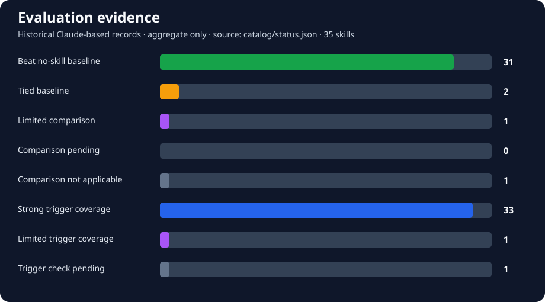

# Evaluation evidence

## Historical scope

This page aggregates the repository's historical **Claude-based** evaluation records. It is not a cross-model leaderboard and does not prove behavior in Codex, Cursor, OpenCode, Gemini CLI, raw APIs, or every Claude configuration. Full model answers, private holdouts and raw session traces are not published in this public release.

## Aggregate results

| Measure | Result | Meaning |
| --- | ---: | --- |
| Skills tracked | 35 | Skills included in the historical aggregate. |
| Skill beat no-skill baseline | 31 | Historical blind comparison recorded a win. |
| Tie with no-skill baseline | 2 | Historical blind comparison recorded a tie; it is not evidence of improvement. |
| Limited comparison | 1 | A quick with/without check is recorded separately from the main set of outcomes. |
| Comparison pending | 0 | A skill has no completed historical with/without outcome. |
| Comparison not applicable | 1 | A command/entry has no standalone knowledge comparison. |
| Trigger checks recorded | 34 | At least one trigger check exists. |
| Strong trigger coverage | 33 | At least 4 correct triggers, no false trigger, three runs. |
| Limited trigger coverage | 1 | A trigger check exists but does not meet the strong-coverage rule. |
| Trigger check pending | 1 | No trigger record exists. |

### Open or non-applicable entries

- **`web-motion`: limited comparison.** Its quick historical test reports three task wins with one execution per task. Its trigger record is also limited (3/5 expected triggers, one run per phrase).
- **`redigir`: comparison not applicable.** It is a guided command for collecting a copywriting brief, rather than a standalone knowledge skill, so the normal "with skill versus without skill" comparison is not meaningful.

## How to read this

- **Wins and ties are counts, not a universal quality score.** Each historical comparison used a task with and without the skill, then a blind judge selected an outcome.
- **Coverage is incomplete.** The historical records are small and some outcomes are pending. A skill can be portable Markdown while its evaluation is only Claude-specific.
- **Public reproduction uses synthetic inputs.** The exact private holdout is deliberately unavailable; users should run the public fixtures or their own non-sensitive evaluation set and report the exact model, harness, command and date.

See the [comparison classification](evaluation-methodology.md#comparison-classification) and [compatibility guide](compatibility.md).
