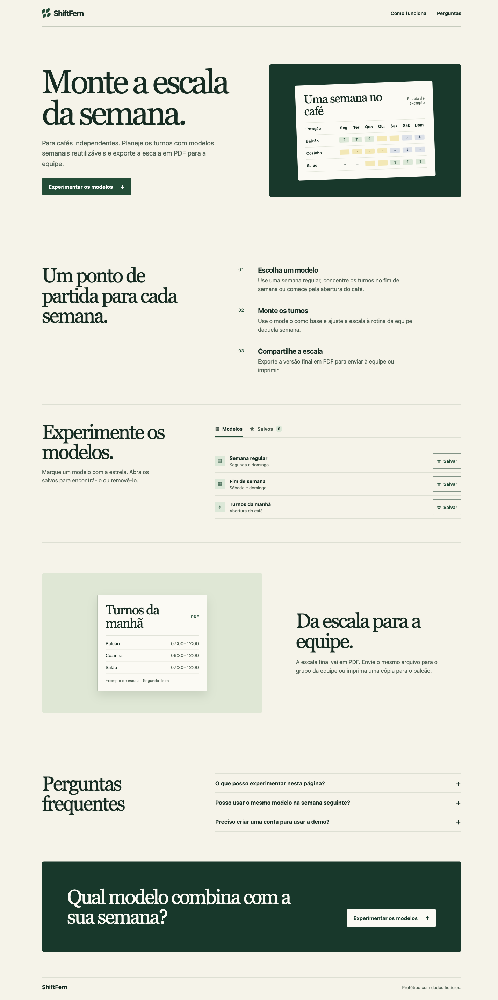

# ShiftFern landing page evaluation

[Follow-up pairs using short and detailed briefs](shiftfern-landing-rounds.md)

[Public fixture](../../evals/public/shiftfern-landing-ui.json) · [Earlier inventory and checkout comparisons](https://github.com/juliomachadome/tested-agent-skills/issues/7#issuecomment-7065318353)

| Version | Status | Evidence |
| --- | --- | --- |
| Authored design reference | Available | Keyboard navigation, FAQ controls, demo save/find/remove, and horizontal overflow were checked on Chromium at 320, 390, 768 and 1440 px. |
| Codex without the repo UI skill | Completed | [Full page PNG](shiftfern-sem-skill.png). |
| Codex with the repo UI skill | Completed | [Full page PNG](shiftfern-com-skill.png). |



[Open the mobile reference](shiftfern-landing-mobile.png). These screenshots illustrate the desired level of visual finish. A previous bundled attempt ended before either model response. The displayed design was authored separately and has no A/B score.

## Observed Codex desktop pair

Two independent agents in the Codex desktop app received the same fixture prompt with no previous conversation. They inherited the same model settings. The tool did not expose the exact model identifier, so the pair is exploratory. One agent received the repository UI skill and read its main file, its style index and minimalist reference, and its polish reference. The other received no repository skill file. No artifact was edited after generation. Both screenshots use the same Chromium viewport setting of 1440 × 900 CSS pixels and extend to the page footer.

Both pages rendered in Portuguese, with no horizontal overflow at 320, 390, 768 and 1440 CSS pixels and no JavaScript exceptions or external asset requests in the initial render. The same interaction passed in both at 390 px with keyboard activation and at 1440 px with pointer activation. The interaction opens the demo, saves one model, finds it in saved models, removes it, shows the empty state and returns focus to a control. The with-skill page used a list with aligned actions. The baseline used cards with miniature schedule previews. The with-skill demo downloaded a PDF for one template. The baseline opened the browser print flow for its example schedule.

This is one pair, without an independent blind judge or user study. The reported observations do not establish a visual winner, natural skill discovery or a wider skill advantage.

## CLI reproduction and review rubric

Use the same prompt, model, effective reasoning settings, session limits and browser profile for each pair. The CLI example supplies only the main skill instructions. It is a related reproduction protocol with a documented exposure difference from the desktop pair. Record the Codex version, model, skill revision, fixture hash and elapsed time. Generate independently and retain final answers privately. Compare masked screenshots at the same width and state. The first paired run is a development observation.

```bash
python3 scripts/codex-skill-compare.py \
  --fixture evals/public/shiftfern-landing-ui.json \
  --model '<model-id>' --runs 3 --answers-dir /path/to/private-directory --live
```

1. Verify Portuguese content and supported claims. Check the primary action, the demo's save/find/remove path by keyboard and pointer, four viewport widths, and console and network behavior. A functional regression blocks a win for that output.
2. Score each UI dimension from 0 to 2, where 0 indicates a clear failure, 1 indicates partial success, and 2 indicates success with concrete visual evidence. The dimensions are first-view hierarchy, design identity grounded in the product, responsive legibility and alignment, and coherent visual states. Review first-view and full-page images with case labels hidden, then repeat with the order reversed. Record one visible observation per score.
3. For this development case, record a visual win at a difference of at least 2 out of 8 when both review orders agree and the winner meets the functional gates. Report a tie if the difference is smaller or the judgment remains inconsistent. Label missing output inconclusive. Avoid extrapolating one case to broad skill quality.

Assess the clarity and factual accuracy of the customer copy and the discoverability of the interaction separately. Claims about where users first click or how they recover require observing people.
